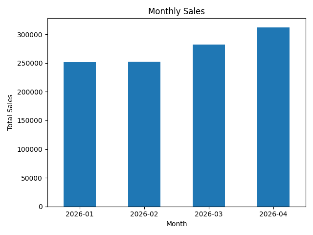
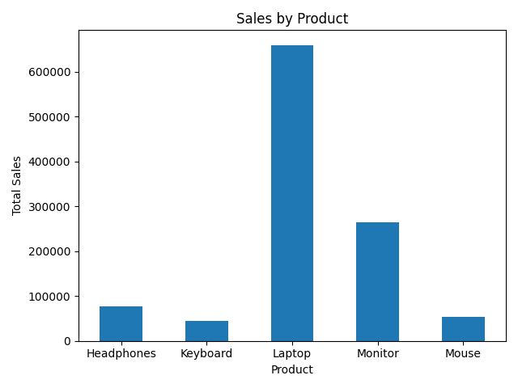
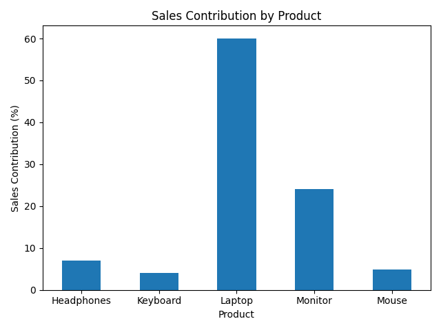

# Sales Data Analysis Using Python

## Project Overview
This project analyzes sales data using Python, Pandas, and Matplotlib. It explores product performance, category revenue, monthly sales trends, and sales contribution.

## Project Objectives
- Analyze total sales revenue.
- Compare sales across products and categories.
- Identify the highest-revenue product.
- Examine monthly sales performance.
- Visualize key findings using charts.

## Tools and Technologies
- Python
- Pandas
- Matplotlib

## Dataset
The dataset contains 24 sales records with the following columns:
- Order_ID
- Date
- Product
- Category
- Quantity
- Unit_Price
- Total_Sales

## Key Findings
- **Total Revenue:** ৳1,098,800
- **Top Revenue Product:** Laptop, generating ৳660,000
- **Highest Quantity Sold:** Mouse, with 44 units
- **Highest Sales Month:** April 2026, with ৳312,300
- **Average Order Value:** ৳45,783.33
- **Electronics Revenue:** ৳924,000

## Visualizations

### Monthly Sales


### Sales by Product


### Sales Contribution by Product


## How to Run the Project

1. Install Python.
2. Download or clone this repository.
3. Open a terminal in the project folder.
4. Install the required libraries:

   `pip install -r requirements.txt`

5. Run the analysis:

   `python analysis.py`

## Project Structure

```text
sales-data-analysis/
├── analysis.py
├── sales_data_analysis.csv
├── monthly_sales.png
├── sales_by_product.png
├── sales_contribution_by_product.png
├── requirements.txt
└── README.md
```

## Author
Afjul Hossain Himel

BSc in Artificial Intelligence and Data Science Student at Green University Of Bangladesh